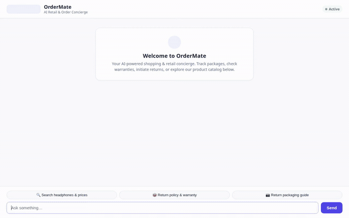

# OrderMate 🛍️📦

> An intelligent, multi-modal retail customer concierge assistant built with the Google Agent Development Kit (ADK) and Gemini on Google Cloud.



---

## Overview

**OrderMate** is a conversational AI concierge designed for modern e-commerce and retail support. It assists shoppers with searching product catalogs, inspecting warranty and return policies, calculating refund estimates, and generating visual demonstrations or packaging guides using Gemini's multi-modal capabilities.

---

## Implemented Capabilities & Wired Services

Based on the codebase in `app/` and `agents-cli-manifest.yaml`, the following services and tools are actively wired and operational:

### 🤖 Core Model & Reasoning
- **LLM Backbone**: Powered by Google's `gemini-3.8-flash` via the `google-genai` SDK on Vertex AI.
- **Agent Framework**: Built with Google ADK (`google-adk`), implementing conversational agent orchestration and JSON-RPC A2A (Agent-to-Agent) compatibility.
- **In-Memory Session Management**: Configured for lightweight session tracking (`session_type: "in_memory"`).

### ☁️ Google Cloud Services & Multi-Modal Tools
- **Google Cloud Storage (GCS)**:
  - Public media bucket integration for storing and serving generated product visuals and demonstration clips without local file dependencies.
- **AI Image Generation (`generate_item_image`)**:
  - Uses `gemini-3.1-flash-lite-image` on Vertex AI to generate crisp product and return-packaging photographs.
  - Automatically saves the generated image bytes to ADK `tool_context` artifacts and uploads to GCS for public HTTPS delivery.
- **AI Video Generation (`generate_item_video`)**:
  - Leverages Google's Omni foundation model (`gemini-omni-flash-preview`) in the `global` region via the Interactions API to synthesize short product demonstration and unboxing clips.
  - Automatically streams video artifacts to ADK artifacts and GCS.
- **Python Code Execution Sandbox**:
  - Wired to `AgentEngineSandboxCodeExecutor` on Vertex AI Reasoning Engine to securely execute Python scripts for price, tax, and discount computations.
- **A2UI (Agent-to-User Interface v0.8 Basic Catalog)**:
  - Generates structured, rich interactive card components (Cards, Columns, Rows, Texts, and Images) via `A2uiSchemaManager` and an `after_model_callback`.

### 🛠️ Domain Tools
- **`search_products`**: Queries retail product catalogs for specifications, ratings, stock, warranty details, and return policies.
- **`get_current_time` & `get_weather`**: Utility tools providing localized time and weather queries.

---

## Roadmap & Planned Features

The following features were outlined in the initial concept brief and are **planned for future releases, but not yet implemented**:

- ⏳ **Cloud Firestore Database**: Persistent storage for customized user order histories and support tickets (*planned, not yet implemented; currently using external catalog lookup and in-memory state*).
- ⏳ **Vertex AI Memory Bank**: Cross-session persistent memory for long-term customer preference tracking (*planned, not yet implemented; currently using in-memory sessions*).

---

## Project Structure

```text
.
├── app/
│   ├── agent.py            # Primary agent definition, tools, and A2UI callbacks
│   └── a2ui_utils.py       # A2UI response formatting & payload normalization
├── frontend/
│   ├── main.py             # FastAPI proxy connecting to the deployed agent
│   └── static/
│       └── index.html      # Styled chat interface with A2UI & video rendering
├── agents-cli-manifest.yaml # Agent runtime deployment specification
├── demo.gif                # Looping demonstration recording
└── pyproject.toml          # Project dependencies and configurations
```

---

## Setup & Local Run Instructions

### 1. Prerequisites
- Python 3.11+
- `uv` package manager (or standard `pip` / `venv`)
- Google Cloud SDK (`gcloud`) authenticated with an active project

### 2. Configure Environment
Set your active Google Cloud Project:
```bash
export GOOGLE_CLOUD_PROJECT="<your-gcp-project-id>"
export GOOGLE_GENAI_USE_VERTEXAI="true"
export GOOGLE_CLOUD_LOCATION="global"
```

### 3. Run the Agent Locally with ADK Dev UI
To interact with the agent in the local developer playground:
```bash
uv run adk web app
```
The ADK web console will start on local port `8000`.

### 4. Run the Custom Frontend UI
To launch the dedicated OrderMate web chat interface:
```bash
cd frontend
python3 -m venv .venv
source .venv/bin/activate
pip install -r requirements.txt
python main.py
```
The custom chat server will start on local port `8080`.
